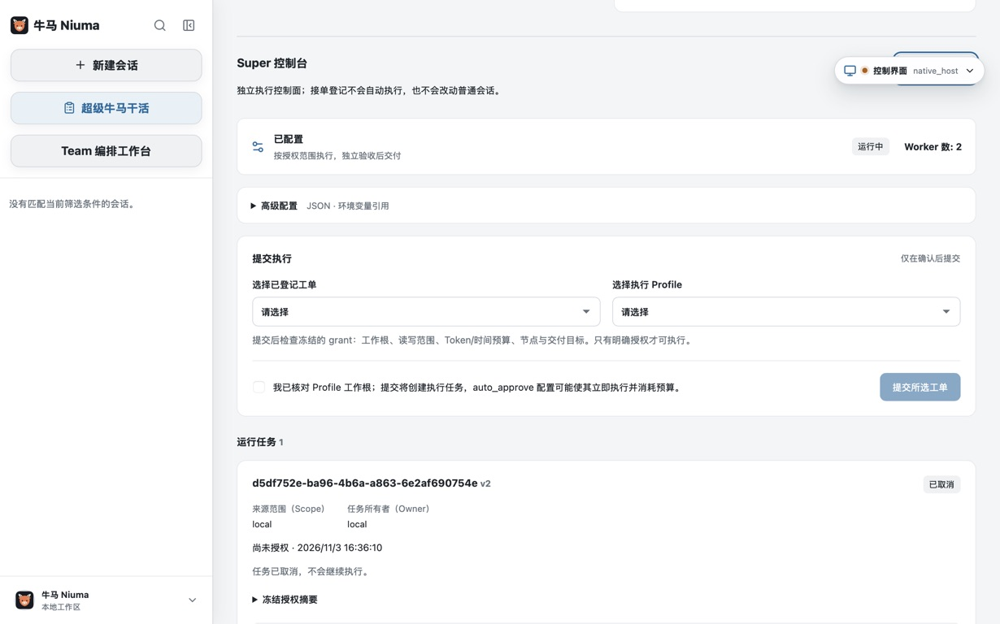
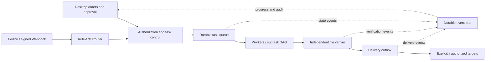

<p align="center">
  
</p>

<h1 align="center">Super Niuma</h1>

<p align="center"><strong>Your super workhorse. Let AI do the grind. Go live your life.</strong></p>
<p align="center">
  An open-source, desktop-first agent workspace: conversations for exploration, work orders for delivery.<br>
  Delegate the task. Keep control of the scope, progress, and acceptance evidence.
</p>

<p align="center">
  <a href="#quick-start">Get started</a> ·
  <a href="#how-it-works">How it works</a> ·
  <a href="docs/usage/super-niuma.md">Super guide</a> ·
  <a href="#project-status">Project status</a> ·
  <a href="CONTRIBUTING.md">Contribute</a> ·
  <a href="README.md">简体中文</a>
</p>

<p align="center">
  <a href="https://github.com/konglong87/super-niuma/actions/workflows/ci.yml"></a>
  <a href="LICENSE"></a>
  
</p>

> **Developer Preview, not a promise of unattended delivery.** The core control plane is implemented, with automated tests and real Desktop interaction evidence. Unified acceptance across a real model and external channels has **not** passed. Start with a small task, explicit permissions, and an inspectable artifact.

<p align="center">
  
</p>
<p align="center"><em>A real macOS Desktop capture, not a mockup. <a href="docs/deployment/2026-11-03-super-niuma-ui-acceptance.md">Read the acceptance record</a>.</em></p>

## Don't just ask whether it can work. Know where the work stands.

A chat window is useful for discussion. Delivery also needs ownership, permissions, budgets, failure handling, and evidence. Super Niuma brings those concerns into one desktop workspace:

| What you need | What Super Niuma provides |
| --- | --- |
| Less switching between tools | **One Desktop, two entry points**: keep ordinary conversations and add a separate Super work-order workspace without rewriting the original Session lifecycle |
| No model call for every routine message | **Rule-first routing**: supported channel commands pass identity, scope, deduplication and deterministic rules without an LLM call |
| Actual division of work, not agents chatting forever | **Multiple workers + bounded subtask DAGs**: dependency-driven execution, parallel reads, and workspace-level write exclusion |
| A record that survives interruptions | **Durable task queues and an event bus**: leases, idempotency, cursors, retries and dead letters; ambiguous external effects are not blindly retried |
| Evidence beyond “I'm done” | **Independent file verification**: reread artifacts, check current-attempt write receipts and SHA-256, then apply configured structured assertions |
| Automation without losing control | **Explicit authorization**: workspace roots, file paths, token/time budgets, delivery targets and stop controls are bounded |

**In short: conversations help you explore; Super work orders help you organize traceable, inspectable delivery.**

## One desktop, two ways to work

| Entry | Best for | Current boundary |
| --- | --- | --- |
| **New session** | Reading and changing code, debugging, handling files, exploring ideas; retained tools, Skills and MCP capabilities | The existing Session and permission model |
| **Super Niuma** | Work with a defined objective, workspace and acceptance rules; tasks that need assignments, budgets, progress and evidence | Separate Super state; workers currently use authorized file reads/writes, not the ordinary session's shell, MCP or Computer Use capabilities |

**A useful first experiment:** clarify a task in an ordinary session, then use a scoped Super profile to produce a small JSON artifact or delivery note with explicit assertions. “High quality” or “fully correct” is not an executable acceptance rule; translate essential requirements into checks or review them yourself.

<a id="quick-start"></a>
## Get started: Desktop first

### 1. Build from source on macOS

Install Go 1.26+, Node.js/npm (see [`web/.nvmrc`](web/.nvmrc)), Wails v2.10.2, and Xcode Command Line Tools. The pinned release toolchain is in [`.tool-versions`](.tool-versions). This repository has no official installer release yet; older project binaries are not Super Niuma builds.

```bash
git clone https://github.com/konglong87/super-niuma.git
cd super-niuma
npm --prefix web ci --legacy-peer-deps
go install github.com/wailsapp/wails/v2/cmd/wails@v2.10.2
export PATH="$(go env GOPATH)/bin:$PATH"
wails doctor
GOSUMDB=sum.golang.org bash scripts/build-desktop-v2.sh
open desktop-v2/build/bin/niuma.app
```

The bundle is currently still named `niuma.app`. Open **Super Niuma** in its sidebar. Platform prerequisites, Windows build instructions and limitations are in the [Desktop guide](desktop-v2/README.md). Super's native acceptance currently covers macOS; Windows file execution remains unavailable.

### 2. Walk through your first work order

1. **Configure your own model service** in Desktop settings. Model access is not bundled. Never paste credentials into Super platform JSON or commit them to Git.
2. **Record the objective and acceptance criteria.** Intake alone makes **no model call, creates no session, and grants no filesystem access**.
3. **Configure a scoped execution profile.** Edit the disabled example: workspace, configured model, node dependencies, read/write paths, budgets and structured verification rules.
4. **Review and approve the grant.** Select the order and profile, then inspect the frozen authorization summary. Only explicitly preauthorized `auto_approve` profiles start automatically.
5. **Inspect progress and evidence.** Check node states, budgets, verification and delivery receipts. Investigate `needs_attention` before retrying.

See the [Super guide](docs/usage/super-niuma.md) for details. Begin with a disposable workspace, a small budget and a local Desktop delivery target. Most detailed guides are currently in Chinese; documentation and translation contributions are welcome.

<details>
<summary><strong>Looking for CLI or Web debugging?</strong></summary>

The traditional CLI is retained:

```bash
go run ./cmd/niuma --help
```

`go run ./cmd/super-niuma` is a loopback **intake-only** HTTP helper. It does not start workers and is not a second product homepage. Do not expose it directly to the public internet. For ordinary conversations, WebUI and configuration, see [Getting started](docs/getting-started.md).

</details>

<a id="how-it-works"></a>
## Separate receiving work, doing work, and checking work



- **The router routes; it does not acquire authority from a prompt.** Identity and permissions come from trusted adapters and configuration. Supported commands use deterministic fast paths; unsupported requests require clarification.
- **Workers execute; they do not certify their own success.** Each attempt has a fresh context and shares the root budget. The control plane bounds concurrency, dependencies and path capabilities.
- **The verifier checks evidence, not confidence.** Passing configured assertions does not prove every natural-language requirement or every software test passed.
- **The queue and bus have different jobs.** The queue schedules work; the bus records notifications and progress. Neither is an unbounded LLM conversation loop.

Built with **Go · Wails · React/TypeScript · SQLite**. Super is currently a single-machine durable control plane, not a claim of cross-machine high availability. File-access protections are not a full OS sandbox. See the [reviewed architecture](docs/architecture/2026-11-03-super-niuma-control-plane.md).

<a id="project-status"></a>
## Project status: implementation is not acceptance

| Capability | Current status |
| --- | --- |
| Desktop entries, work orders, configuration, approval and cancellation | Implemented; real app interactions, restart readback and screenshots recorded |
| Router, multiple workers/subtask DAGs, budgets and durable bus | Implemented; automated, concurrency and SQLite recovery tests |
| Independent file verification, outbox and scope isolation | Implemented; code tests do not replace live integration acceptance |
| Desktop, Feishu and signed Webhook adapters | Implemented; real external-account and recipient acceptance remains incomplete |
| Autonomous delivery with a real model | **Not accepted yet**: the bounded November 3, 2026 recheck received provider HTTP 429 and stopped instead of retrying in a loop |
| One order across native UI, a real model and external channels | **Not accepted yet**; this remains a delivery gate |
| Official signing and installer distribution | No release yet; use the source-built developer preview |

Read the [UI and regression evidence](docs/deployment/2026-11-03-super-niuma-ui-acceptance.md), [model recheck](docs/deployment/2026-11-03-super-niuma-model-recheck.md), and [delivery ledger](docs/plans/2026-11-03-super-niuma-platform-delivery.md). Mocks, unit tests and “adapter started” are not presented as successful real-world delivery.

## Local-first, with explicit external boundaries

- Super work orders and control state live separately in `~/.super-niuma`. Model routes default to `~/.niuma/settings.json`. Super does not reuse the original Session database.
- Only authorized execution calls a model. Check whether your inputs and artifacts may be sent to the configured service.
- Cross-channel delivery uses explicitly approved targets and defaults to safe status summaries, not source code or another channel's raw content.
- Unknown model usage or external effects remain visible and require inspection; they are not silently refunded, resent or labeled successful.
- Retained Computer Use is a **macOS single-display Developer Preview**. A second physical display and formal signing remain outside the accepted scope. Super does not currently initiate Computer Use.

Read [Security](SECURITY.md), the [Super guide](docs/usage/super-niuma.md), and [Computer Use scope](docs/usage/computer-use.md) before running an agent.

## Help turn a hard-working mascot into a dependable teammate

Try it with **a concrete task and an inspectable result**. You do not need to change the runtime to help:

- [Share first-run feedback](https://github.com/konglong87/super-niuma/issues/new/choose): what was unclear, where you got stuck, and what you expected.
- Contribute a sanitized model-compatibility, channel-integration or recovery case with reproduction steps. Leave out credentials and real user data.
- Improve documentation, translations, accessibility, interactions or tests. Read [Contributing](CONTRIBUTING.md) and keep each PR focused.

If this direction resonates, **Star** the project to help others discover it, or **Watch** for updates. A reproducible issue or an honest acceptance record is just as valuable.

<details>
<summary><strong>More documentation and provenance</strong></summary>

- [Super guide](docs/usage/super-niuma.md) · [Architecture](docs/architecture/2026-11-03-super-niuma-control-plane.md) · [Delivery ledger](docs/plans/2026-11-03-super-niuma-platform-delivery.md)
- [Ordinary-session setup](docs/getting-started.md) · [Use cases](docs/use-cases.md) · [Configuration](docs/configuration.md)
- [WebUI](docs/usage/webui.md) · [Traditional Feishu integration](docs/usage/feishu.md) · [Desktop personalization](docs/usage/desktop-personalization.md)
- [Contributing](CONTRIBUTING.md) · [Code of conduct](CODE_OF_CONDUCT.md) · [Changelog](CHANGELOG.md)

Super Niuma is an independent public successor built from a Niuma source snapshot, preserving the traditional Session implementation. Niuma's upstream lineage is go-e2e. Exact source baselines and Apache-2.0 licensing are recorded in [UPSTREAM.md](UPSTREAM.md) and [LICENSE](LICENSE); upstream attribution does not imply endorsement.

Niuma's original bull-horse mascot captures the idea: **work hard, show evidence, and hand off when a boundary is reached.**

</details>
