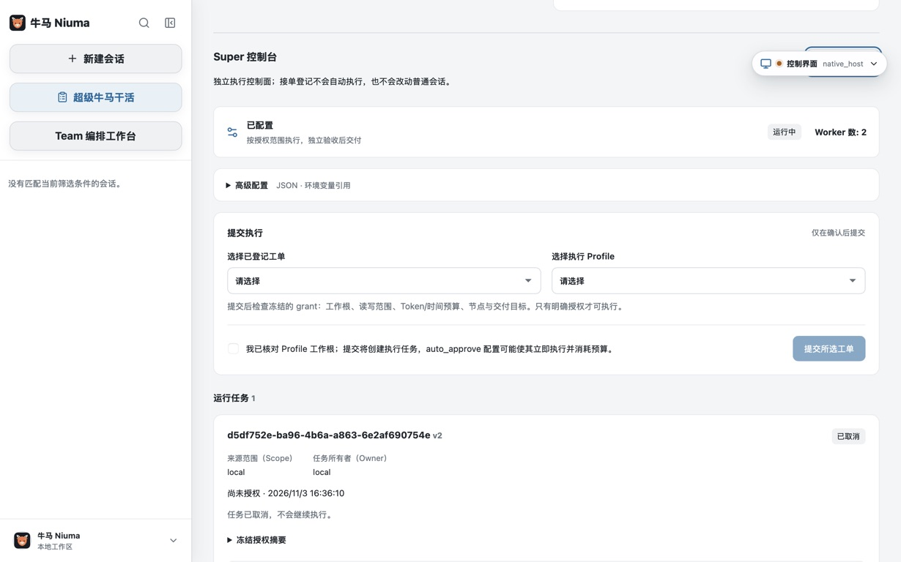
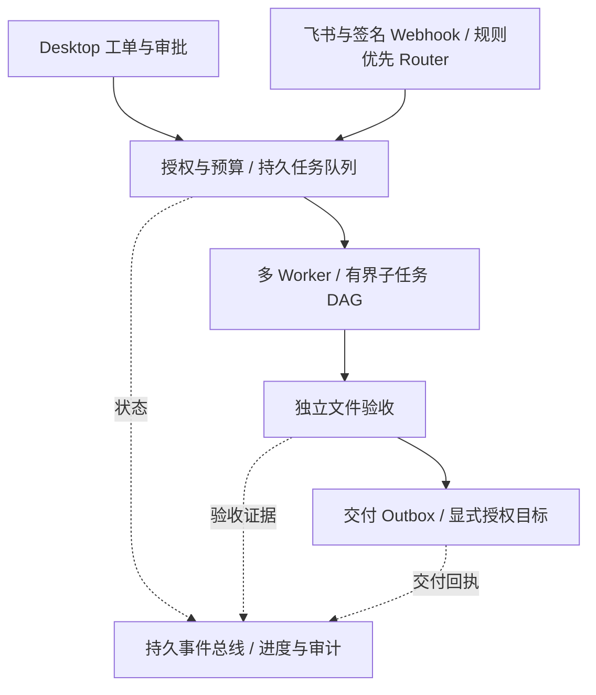

<p align="center">
  
</p>

<h1 align="center">Super Niuma · 超级牛马</h1>

<p align="center"><strong>你的超级牛马。让 AI 当牛马，人类去生活。</strong></p>
<p align="center">
  开源、桌面优先的 Agent 工作台：日常任务用会话，明确交付用工单。<br>
  把目标交给牛马，把授权、过程和验收证据留在你手里。
</p>

<p align="center">
  <a href="#quick-start">开始使用</a> ·
  <a href="#how-it-works">工作原理</a> ·
  <a href="docs/usage/super-niuma.md">使用指南</a> ·
  <a href="#project-status">当前进展</a> ·
  <a href="CONTRIBUTING.md">参与贡献</a> ·
  <a href="README.en.md">English</a>
</p>

<p align="center">
  <a href="https://github.com/konglong87/super-niuma/actions/workflows/ci.yml"></a>
  <a href="LICENSE"></a>
  
</p>

> **开发预览，不是无人值守交付承诺。** 核心控制面已实现，原生 Desktop 交互与自动测试已有验收记录；真实模型与外部渠道的统一端到端验收仍未通过。先从小任务、明确权限和可检查的产物开始。

<p align="center">
  
</p>
<p align="center"><em>真实 macOS Desktop 截图，不是概念图。<a href="docs/deployment/2026-11-03-super-niuma-ui-acceptance.md">查看验收记录</a></em></p>

## 不只问“能不能做”，还要知道“做到了哪里”

聊天窗口适合讨论；交付任务还需要负责人、权限、预算、失败处理和验收依据。Super Niuma 把这些放进同一个桌面工作台：

| 你关心的事 | Super Niuma 的做法 |
| --- | --- |
| 不想在多个工具之间来回切换 | **一个 Desktop，两个入口**：保留普通会话，新增“超级牛马干活”，不重写原 Session 生命周期 |
| 简单消息不值得浪费模型请求 | **规则优先 Router**：已支持的渠道命令先做身份、范围、去重和规则判断，不为它们调用 LLM |
| 复杂任务需要分工，而不是几个 Agent 互相聊天 | **多 Worker + 有界子任务 DAG**：按依赖执行，可并行读取，写入受工作根互斥约束 |
| 重启、重复消息、半途失败不能变成一笔糊涂账 | **持久任务队列 + 事件总线**：租约、幂等、游标、重试与死信有记录；未知外部结果不盲重试 |
| 不希望 Agent 自己说“完成”就算交付 | **独立文件验收**：重读产物、核对当前执行的写入凭证与 SHA-256，再检查配置中的结构化规则 |
| 想自动干活，也想保留决定权 | **先授权，再执行**：工作根、读写路径、Token/时间预算、目标渠道和停止操作都有明确边界 |

**一句话：普通会话帮你探索，Super 工单帮你组织一次可追踪、可检查的交付。**

## 一个桌面，两种工作方式

| 入口 | 适合什么 | 当前边界 |
| --- | --- | --- |
| **新建会话** | 阅读与修改代码、调试、处理文件、探索方案；沿用现有工具、Skills 与 MCP 能力 | 使用原有 Session 与权限机制 |
| **超级牛马干活** | 已明确目标、工作目录和验收规则的工单；需要分工、预算、状态和证据的任务 | 独立 Super 状态；当前 Worker 仅使用授权文件读写，不自动继承普通会话的 shell、MCP 或 Computer Use |

**适合先试的小任务**：先在普通会话里梳理需求，再用 Super 的受限文件工具生成一份结构明确的 JSON 或交付说明，并配置相应断言。自然语言里的“质量好”“完全正确”不能自动变成验收标准；仍需你把关键要求写成规则或人工检查。

<a id="quick-start"></a>
## 开始使用：推荐 Desktop

### 1. 从源码构建（macOS）

准备 Go 1.26+、Node.js/npm（版本见 [`web/.nvmrc`](web/.nvmrc)）、Wails v2.10.2 与 Xcode Command Line Tools。发布工具链见 [`.tool-versions`](.tool-versions)。当前没有本仓库的正式安装包；旧项目安装包不等于 Super Niuma。

```bash
git clone https://github.com/konglong87/super-niuma.git
cd super-niuma
npm --prefix web ci --legacy-peer-deps
go install github.com/wailsapp/wails/v2/cmd/wails@v2.10.2
export PATH="$(go env GOPATH)/bin:$PATH"
wails doctor
GOSUMDB=sum.golang.org bash scripts/build-desktop-v2.sh
open desktop-v2/build/bin/niuma.app
```

构建产物目前仍叫 `niuma.app`；启动后在侧栏进入 **“超级牛马干活”**。完整平台依赖、Windows 构建方式和限制见 [Desktop 构建指南](desktop-v2/README.md)。Super 的原生验收目前基于 macOS，Windows 文件执行能力尚未开放。

### 2. 走完第一张工单

1. **配置自己的模型服务**：在 Desktop 模型设置中配置 Provider、端点与凭据；不附赠模型额度。不要把密钥贴进 Super 平台 JSON 或 Git。
2. **登记目标和验收条件**：工单登记只记录需求，**不会调用模型、创建会话或授予目录访问权限**。
3. **配置受限执行方案**：修改控制台中默认禁用的样例，指定工作根、模型、节点依赖、读写范围、预算及结构化验收规则。
4. **检查并批准授权**：选择工单与方案，核对冻结的授权摘要；只有显式预授权的 `auto_approve` 方案才会自动启动。
5. **看状态与证据**：检查各节点、预算、独立验收报告和交付回执；遇到 `needs_attention` 先核实原因，不盲重试。

详细说明见 [Super 使用指南](docs/usage/super-niuma.md)。优先使用临时测试目录、小预算和 Desktop 本地交付目标。

<details>
<summary><strong>需要 CLI 或 Web 调试入口？</strong></summary>

传统 CLI 保留在同一仓库：

```bash
go run ./cmd/niuma --help
```

`go run ./cmd/super-niuma` 是本机 **intake-only** HTTP 调试工具，不启动执行 Worker，不是另一个产品首页；不要将其直接反代到公网。普通会话、WebUI 与配置说明见 [入门指南](docs/getting-started.md)。

</details>

<a id="how-it-works"></a>
## 工作原理：把接单、干活、验收分开



- **Router 管分流，不越权干活**：渠道身份与授权来自受信适配器和配置，不由消息正文或模型决定。普通命令走确定性快路径；不支持的请求先澄清，不猜权限。
- **Worker 管执行，不自证成功**：每次 attempt 都有独立上下文和共享根预算；并发、依赖及路径能力受控制面约束。
- **Verifier 管证据，不信口头承诺**：通过的是所配置规则，不等于所有自然语言要求或所有软件测试都已通过。
- **队列与 Bus 分工**：任务队列负责调度，事件总线负责可追溯通知；不是把所有消息扔给一个无限循环的 LLM。

技术栈：**Go · Wails · React/TypeScript · SQLite**。当前 Super 是单机持久控制面，不宣称跨机器高可用，也不把文件访问防护称为完整 OS 沙箱。深入设计见 [控制面架构](docs/architecture/2026-11-03-super-niuma-control-plane.md)。

<a id="project-status"></a>
## 当前进展：能做什么，哪些还需要验收

| 能力 | 当前状态 |
| --- | --- |
| Desktop 双入口、工单、配置、审批与取消 | 已实现；有真实 App 操作、重启读回和截图验收 |
| Router、多 Worker/子任务 DAG、预算、持久 Bus | 已实现；有自动测试、并发与 SQLite 恢复测试 |
| 独立文件验收、通知 Outbox、作用域隔离 | 已实现；代码测试不替代真实模型/渠道验收 |
| Desktop、飞书、签名 Webhook 接入 | 已有适配器；真实外部账号与收件目标的收发验收尚未完成 |
| 真实模型自动交付闭环 | **尚未通过**：2026-11-03 最近一次受限复测遇到供应商 HTTP 429，已停止而非循环重试 |
| 同一工单贯通原生 UI、真实模型和外部渠道 | **尚未通过**；是接下来的交付门禁 |
| 正式签名与安装包分发 | 尚未发布；目前以源码开发预览为主 |

可核对的 [UI 与自动回归验收记录](docs/deployment/2026-11-03-super-niuma-ui-acceptance.md)、[模型复测结果](docs/deployment/2026-11-03-super-niuma-model-recheck.md) 和 [按依赖排序的交付账本](docs/plans/2026-11-03-super-niuma-platform-delivery.md) 都公开保留。不会把 mock、单测或“适配器已启动”包装成真实交付成功。

## 本地优先，不代表没有外部边界

- Super 工单与控制面使用独立的 `~/.super-niuma`；普通模型路由配置默认在 `~/.niuma/settings.json`。Super 不复用原 Session 数据库。
- 只有经过授权的执行才调用模型；输入与产物是否适合发送给你配置的服务，需要你自行确认。
- 跨渠道交付只使用显式批准的目标，默认发送安全状态摘要，不自动广播源码或其他渠道的原文。
- 模型用量或外部动作结果不确定时，保留账本并停下来核实；不会为显示“成功”而退款、重发或隐去失败。
- 保留的 Computer Use 是 **macOS 单屏 Developer Preview**；第二物理显示器与正式签名仍未验收。Super 当前不启动 Computer Use。

运行前请阅读 [安全说明](SECURITY.md)、[Super 使用指南](docs/usage/super-niuma.md) 与 [Computer Use 范围](docs/usage/computer-use.md)。

## 一起把超级牛马养成真正靠谱的伙伴

欢迎带着一个**具体任务和可检查的结果**来试用，而不是只给一句“没跑通”。第一次参与可以从这些地方开始：

- [反馈首次使用体验](https://github.com/konglong87/super-niuma/issues/new/choose)：哪里不清楚、哪个步骤卡住、你期待看到什么。
- 补充脱敏的模型兼容性、渠道接入或故障恢复案例；附复现步骤和安全诊断，不上传密钥与真实用户数据。
- 改善文档、英文表达、无障碍、交互细节或测试。先读 [贡献指南](CONTRIBUTING.md)，让每个 PR 聚焦一个问题。

如果这个方向对你有用，欢迎 **Star** 让更多人发现，或 **Watch** 跟进进展。一个可复现的 Issue、一份真实验收记录，同样是很有价值的支持。

<details>
<summary><strong>更多文档与来源</strong></summary>

- [Super 操作指南](docs/usage/super-niuma.md) · [控制面架构](docs/architecture/2026-11-03-super-niuma-control-plane.md) · [交付账本](docs/plans/2026-11-03-super-niuma-platform-delivery.md)
- [普通会话入门](docs/getting-started.md) · [使用场景](docs/use-cases.md) · [配置参考](docs/configuration.md)
- [WebUI](docs/usage/webui.md) · [传统飞书渠道](docs/usage/feishu.md) · [桌面个性化](docs/usage/desktop-personalization.md)
- [贡献](CONTRIBUTING.md) · [行为准则](CODE_OF_CONDUCT.md) · [更新日志](CHANGELOG.md)

Super Niuma 是基于 Niuma 源码快照演进的独立公开项目，保留传统会话实现。Niuma 的上游来源为 go-e2e。完整提交基线、代码来源和许可见 [UPSTREAM.md](UPSTREAM.md) 与 [Apache-2.0 LICENSE](LICENSE)；不代表上游为本项目背书。

牛角马耳的小牛马是项目的原创角色：**勤快但不逞强，做完展示证据，遇到边界就交接。**

</details>
